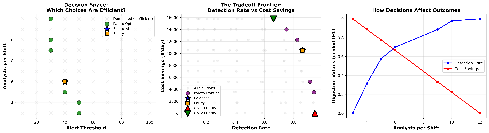

# CrowdStrike Falcon Complete: SOC Alert Triage Optimization

## Overview
This project analyzes how a security operations center does balance detection coverage against analyst labor cost by choosing an alert-score threshold and a staffing level. It identifies every efficient combination using a Pareto frontier analysis.

## Business Problem
Deciding which alerts are just noise and which alerts we need to investigate further are one of the most difficult parts of a SOC analyst job. An analyst can spend time on alerts that are just noise and ignore the important ones. The solution for this is building a model that can optimizes alert threshold and staff to be more efficient. If we start to hire more analyst or lowering the threshold it would catch more attacks but it will cost more, at the same time cutting staff saves money but it puts a company in risk for an attack, per IBM, 4.44 million on average.

## Status
Part 1: Optimization Engine (Unit 11) Complete

### What It Does

The optimization system looks at 100 possible combinations of the alert limit and number of analysts for each shift to produce a Pareto frontier of feasible solutions with an acceptable compromise between the detection rate and minimization of labour.

### Key Findings

- Only 7% of the proposed solutions are Pareto-optimal.
- It is recommended to avoid the other 93 solutions.
- Key strategic points on the frontier include detection priority (threshold of 30 takes 12 analysts to reach the 94.5% detection level), cost priority (threshold of 50 will save $15768 with 3 analysts) and balanced option (threshold of 40 requires 6 analysts to achieve 86.0% detection and the $10512 savings).

## Technical Approach

- **Data:** One hundred synthetic combinations were created by multiplying 10 levels of alerting threshold by 10 levels of labour staffing. The prompt as well as the data generation process are explained in file `data/data_generation_prompt.txt`. The daily labour cost is converted into savings, making both criteria to be “the bigger the better”.
- **Pareto frontier:** Each combination is tested for both criteria when compared to all other combinations. A combination is dominated if there is another combination that satisfies at least both of the criteria, and outperforms the first combination on at least one criterion.
- **Strategies:** Five strategic points (balancing point, equity point, priority of detection, priority of cost and weighted point in 60/40 ratio) are determined on the frontier.

## Limitations

The information provided is synthetic and includes just 100 combinations. The model is based on two decision variables and two objectives while assuming that all analysts work equally well at a constant hourly rate. There are no restrictions placed at this point, and the balance is estimated to have an average critical response time of 17 minutes, which is still in excess of the previous 15 minute target. These limitations will be added in Part 2.

### Running the Analysis

1. Make sure you have the necessary libraries of `pandas`, `numpy`, `matplotlib`
2. Launch `optimization_engine.ipynb`
3. Run all of the cells from start to finish
4. The outputs will be automatically stored in the `images/` directory

### Next Steps

Part 2 will introduce a decision agent that can choose from all the Pareto optimal solutions, based on the business constraints and objectives.

## Technologies
- Python
- Pandas
- NumPy
- Matplotlib
- Jupyter Notebook

## Setup

1. Clone the repository
2. Install the packages: `pip install -r requirements.txt`
3. Open `optimization_engine.ipynb` in Jupyter or VS Code
4. Click "Restart & Run All" to reproduce the analysis